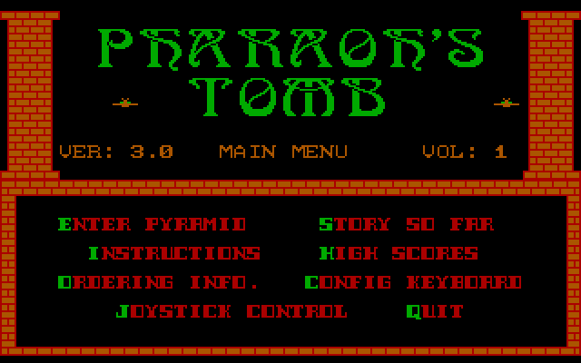
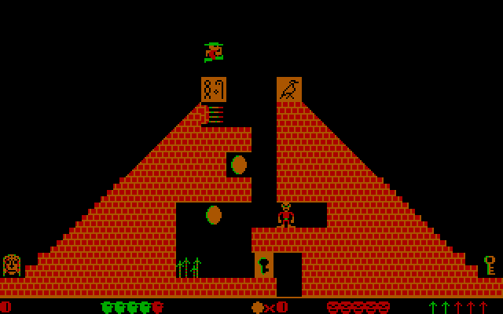
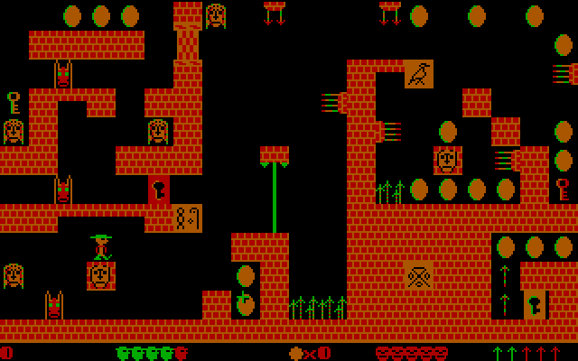
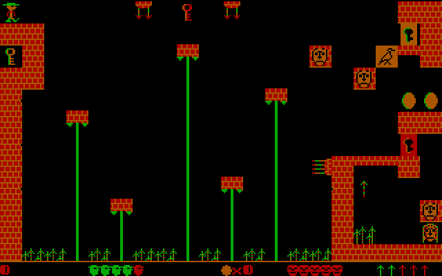

# Pharaoh's Tomb port

A personal learning project: reverse engineering Pharaoh's Tomb (Micro/FX / Apogee, 1990,
re-released as freeware in 2009) with Ghidra, then porting it to run natively on modern systems.

| | |
|:---:|:---:|
|  |  |
| The main menu | Level 1: At the Pyramid |
|  |  |
| Level 4: The Chamber of Isis | Level 5: The Grand Gallery |

## Layout

| Path        | Contents                                                        |
|-------------|-----------------------------------------------------------------|
| `src/`      | The port: C11 + SDL2                                            |
| `game/`     | Original game files (not committed, copy them in yourself)      |
| `unpacked/` | Decompressed EXEs produced by `tools/unlzexe.py` (not committed) |
| `tools/`    | Python helpers: unpacker, Ghidra dump/rename, graphics and level extractors |
| `analysis/` | Ghidra function names (`PTOMB1.names.txt`)                      |
| `docs/`     | Reverse engineering notes (`notes.md`)                          |

## The port

The port contains no game assets. At startup it reads the sprites and level layouts out of
your own `PTOMBn.EXE`, packed or unpacked, and reimplements the game logic in C on top of a
Graph3-style 320x200 CGA framebuffer.

**The whole game is there**, all four volumes: every level, tile, enemy and sound effect,
the title screen and menus, high scores, saved games, the end-of-volume story and the cheats,
compatible with the original's `.HS` and `.SAV` files. The only differences:

- **Picture transitions** on the title and menu screens are simple wipes, not the original's
  Genus PCX effects.
- **Punctuation and lowercase text** use the port's own 8x8 font, standing in for the IBM BIOS
  font, which can't be shipped. Everything else is drawn in the game's own fonts.
- **Quitting to DOS** doesn't show the original's final text-mode screen; the window just
  closes.
- **Joystick:** modern controllers stand in for it and it starts switched on (see below), and
  its fire button can no longer throw spears you don't have.

Port extras: a choice of palettes (green/red/brown by default, or the original's
cyan/magenta/white), 4:3 aspect correction, screenshots and level skipping (see the keys below).

The port reads `PTOMBn.MNU`, `PTOMBn.HS`, `PTOMBn.SAV` and `PTOMB.CFG` from the folder the EXE
is in, and **writes** `PTOMBn.HS` (a new high score), `PTOMB.CFG` (Config Keyboard) and
`PTOMBn.SAV` (S in game) there, as the original does.

### Getting the game

The port needs the original game files, which Apogee released as freeware in 2009. They come
as `tombfree.zip` (217 KB, all four volumes) from either of these:

- [DOS Games Archive: Pharaoh's Tomb](https://www.dosgamesarchive.com/download/pharaohs-tomb)
  (the game's page, which can also run it in the browser), or its
  [direct download](https://www.dosgamesarchive.com/file/pharaohs-tomb/tombfree)
- [Dukeworld: Apogee freeware archive](https://dukeworld.com/2001-current/apogee%20freeware/)
  (a folder of Apogee's freeware releases; pick `tombfree.zip`)

Unzip it next to `ptomb.exe` (for a release download) or into `game/` (when building from
source). The port only needs `PTOMBn.EXE` and `PTOMBn.MNU`; the other files are created as
you play.

### Build (Windows, MSYS2 mingw64)

Needs the MSYS2 packages `mingw-w64-x86_64-gcc`, `-cmake`, `-ninja` and `-SDL2`. From a shell
with `C:\msys64\mingw64\bin` on `PATH`:

```
cmake -S . -B build -G Ninja -DCMAKE_BUILD_TYPE=Release
cmake --build build
```

That produces `build/ptomb.exe` with `SDL2.dll` copied next to it. On Linux/macOS the same
commands work with SDL2 installed through your package manager.

### Run

```
build/ptomb.exe game/PTOMB1.EXE
```

With a release download, double-click `ptomb.exe` in the folder with the game files to play
volume 1, or run `ptomb.exe PTOMB2.EXE` (and so on) for the others. Dropping a `PTOMBn.EXE`
onto `ptomb.exe` works too.

Menu keys as in the original: E, Space or Enter to play, I instructions, S story, H high scores,
O ordering info, C config keyboard, J joystick, Q quit.

Game keys (the original's):

| Key | Action |
|-----|--------|
| Left / Right | walk (pressing against your facing first turns you round) |
| Ctrl / Alt | walk left / right, the alternate keys (`--keys 1`: Shift, `--keys 2`: Alt / Ctrl) |
| Space | jump |
| Z X C V B N M , . / F | throw a spear |
| P | pause |
| S / R | save / restore (the save holds the state the current level started with) |
| E | sound effects on/off |
| Q or Esc, then Y | quit to the main menu |
| Scroll Lock on + `+` | cheat: skip to the next level |

Game controllers stand in for the original's PC joystick. Most current pads (Xbox,
PlayStation, Switch Pro, 8BitDo and others) are recognised automatically and can be plugged in
at any time; for anything else, put a [`gamecontrollerdb.txt`](https://github.com/mdqinc/SDL_GameControllerDB)
next to `ptomb.exe`, and an unrecognised joystick still works through its first two axes and
buttons. Unlike the original, the joystick starts switched on; J in the main menu turns it
off or recalibrates it, as in the game.

| Control | In game | Menus and "press any key" | QUIT (Y/N)? |
|---------|---------|---------------------------|-------------|
| Left stick / d-pad | walk | | |
| A | jump | Enter | Y |
| B or X | throw a spear | B: Esc | B: N |
| Start | pause | Enter | Y |
| D-pad | | moves the menu cursor (enhanced) | |
| Back / View | quit prompt | | N |

The original's joystick fire button didn't check your spear count, so it kept throwing at
zero and the count went negative; the port fixes that.

Port keys:

| Key | Action |
|-----|--------|
| PgUp / PgDn | previous / next level |
| F1 | CGA palette 0 (green/red/brown, default) or 1 (cyan/magenta/white, the original) |
| F2 | low / high intensity |
| F3 | 4:3 aspect correction on/off |
| F11 or Alt+Enter | fullscreen on/off |
| F12 | save a screenshot PNG in the current directory |

### Settings

The port has two presets: **classic**, the original game exactly as released in v1.0.0 (the
default), and **enhanced**, which switches on every enhancement. So far that is:

- **Main menu cursor** (`menu.navigation`): a highlight you move with the arrow keys, the
  d-pad or the mouse, and choose with Enter, Space, A or a click. The letter keys still work.
  Clicks also count as a key on "press any key" screens. (In classic, as in the original,
  the arrow keys type letters: Up opens the high scores.)

Choose a preset with `--classic` or `--enhanced`, or in a `ptomb.ini` file next to
`ptomb.exe`, which can also change single settings:

```ini
[game]
preset = classic      ; or enhanced

[display]
palette = 0           ; 0 = green/red/brown, 1 = cyan/magenta/white (the original's)
bright = off
aspect = on           ; stretch to 4:3, as a CRT showed it
fullscreen = off      ; F11 or Alt+Enter switches

[input]
joystick = on         ; start with the controller on (the original started with it off)

[menu]
navigation = off      ; the main menu cursor (on in enhanced)
```

`ptomb --print-settings > ptomb.ini` writes a complete file with every setting explained.
The command line overrides the file: `--set display.palette=1`, for example. F1-F3 and F11
change the display settings for the current run only.

### Command line

```
ptomb [PTOMBn.EXE] [options]
```

The EXE defaults to `PTOMB1.EXE` in the current folder.

| Option | What it does |
|--------|--------------|
| `--classic` / `--enhanced` | choose the preset (overrides `ptomb.ini`) |
| `--set section.key=value` | change one setting, e.g. `--set display.aspect=off` (can be repeated) |
| `--config FILE` | read settings from FILE instead of `ptomb.ini` next to `ptomb.exe` |
| `--print-settings` | print the current settings as a `ptomb.ini` and exit |
| `--palette 0\|1` | start in palette 0 (green/red/brown, the default) or 1 (cyan/magenta/white, the original) |
| `--bright` | start in high intensity (short for `--set display.bright=on`) |
| `--keys 1\|2\|3` | the walking keys: Shift, Alt / Ctrl or Ctrl / Alt (overrides `PTOMB.CFG`) |
| `--cheat` | the menu cheat: invincible, with unlimited spears |
| `--level N` | skip the title and menu, play level N, and exit when you quit |

For testing and development:

| Option | What it does |
|--------|--------------|
| `--screenshot out.png` | render a level (1, or the one given with `--level`) to a PNG and exit, without a window |
| `--ending` | show this volume's ending pages |
| `--sound-test` | play every sound effect once, named in the title bar |
| `--record-audio out.wav` | record everything the PC speaker plays |
| `--debug-exe` | print what the port found in the EXE |
| `--script "..."` | play scripted input (below) |

A script is a list of commands separated by `;`, timed in ticks of the 18.2 Hz timer. For
example, `--script "wait 70; down right; wait 18; up right; shot a.png; quit"`.

| Command | What it does |
|---------|--------------|
| `wait N` | wait N ticks |
| `down KEY` / `up KEY` | press / release a key |
| `tap KEY` | press a key for one tick |
| `shot FILE.png` | save a screenshot |
| `mouse X Y` / `click X Y` | move the mouse / click, in 320x200 screen pixels |
| `quit` | close the port |

`KEY` is `left`, `right`, `up`, `down`, `space`, `esc`, `enter`, `pgup`, `pgdn`, `f11` or a single
character, or a control on a virtual game controller: `pad_a`, `pad_b`, `pad_x`, `pad_start`,
`pad_back`, `pad_left`, `pad_right`, `pad_up` or `pad_down`.

## Reverse engineering workflow

The shipped `PTOMBn.EXE` files are compressed with LZEXE 0.91, so Ghidra only sees the
decompression stub. Unpack them first:

```
python tools/unlzexe.py game/PTOMB1.EXE unpacked/PTOMB1.EXE
```

Then import `unpacked/PTOMB1.EXE` into Ghidra (format: Old-style DOS Executable (MZ)), run
auto-analysis, and apply the known names with
`python tools/ghidra_rename.py analysis/PTOMB1.names.txt` (needs GhidraMCP running).

## License

The port's source code and tools are released under the MIT License (see `LICENSE`). That
covers this repository only: Pharaoh's Tomb itself is (c) 1990 Micro F/X and Apogee Software,
distributed as freeware, and none of its files are included here.
